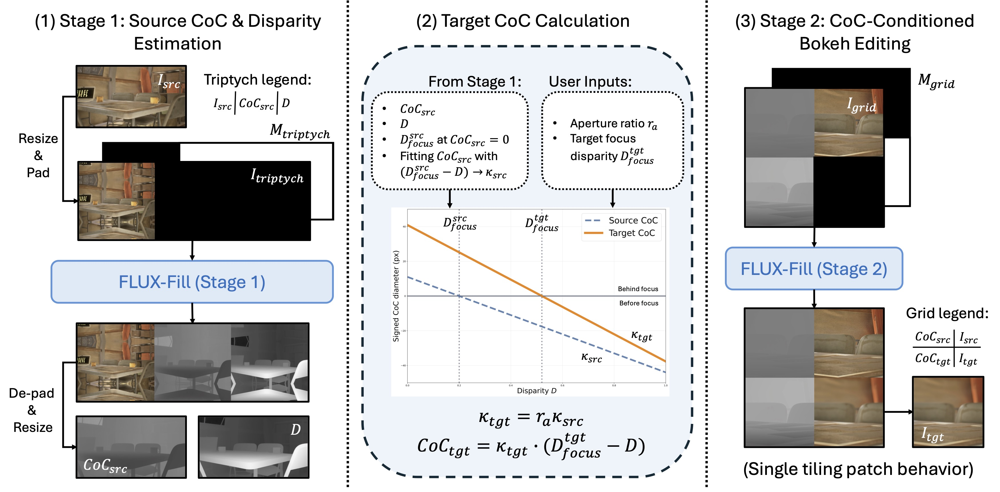

<div align="center">

# AnyBokeh: Physics-Guided Any-to-Any Bokeh Editing with Optical Fingerprint Transfer

[Xinyu Hou](https://itsmag11.github.io/), [Xiaoming Li](https://csxmli2016.github.io/), [Zongsheng Yue](https://zsyoaoa.github.io/), [Chen Change Loy](https://www.mmlab-ntu.com/person/ccloy/)

S-Lab, Nanyang Technological University

**NeurIPS 2026**

[](https://arxiv.org/abs/2606.31959)
[](https://itsmag11.github.io/AnyBokeh/)
[](https://huggingface.co/itsmag11/AnyBokeh)
[](https://huggingface.co/datasets/itsmag11/UnrealBokeh)
[](https://github.com/itsmag11/AnyBokeh)

</div>

## 🎯 Project Overview

**AnyBokeh** aims to achieve physics-grounded any-to-any bokeh editing by transforming an image from an arbitrary source optical state to a desired target focus and aperture setting through optical fingerprint transfer and dual-CoC conditioning.



## 📋 TODO

- [x] Release inference code and pretrained checkpoints
- [x] Release training code
- [x] Release UnrealBokeh dataset

## 📑 Contents

- [Preparation](#preparation)
  - [Environment Setup](#environment-setup)
  - [Checkpoints](#checkpoints)
  - [Dataset](#dataset)
- [Inference](#inference)
  - [End-to-End (Stage 1 + Stage 2)](#end-to-end-stage-1--stage-2)
  - [Picking the Focus Point](#picking-the-focus-point)
  - [Running the Stages Separately](#running-the-stages-separately)
- [Training](#training)
  - [Stage 1](#stage-1)
  - [Stage 2](#stage-2)
    - [Pretraining](#pretraining)
    - [Finetuning](#finetuning)
- [Citation](#citation)
- [License](#license)

## 🛠️ Preparation

### Environment Setup

```bash
# Create conda environment
conda create --name anybokeh python=3.10
conda activate anybokeh

# Install PyTorch (CUDA 12.4)
pip install torch==2.6.0 torchvision==0.21.0 --index-url https://download.pytorch.org/whl/cu124

# Install dependencies
pip install diffusers==0.37.0 transformers==5.3.0 peft==0.18.1 accelerate==1.13.0 huggingface_hub==1.6.0 scipy opencv-python
```

### Checkpoints

AnyBokeh is built on [FLUX.1-Fill-dev](https://huggingface.co/black-forest-labs/FLUX.1-Fill-dev), which is gated: accept its license on the model page and run `hf auth login`. The base model and our [checkpoints](https://huggingface.co/itsmag11/AnyBokeh) are then downloaded automatically at the first run.

For offline use, download our checkpoints with `hf download itsmag11/AnyBokeh --local-dir checkpoints` and pass `--anybokeh_model_name_or_path checkpoints`. The files are in that folder's root: `stage1-pytorch_lora_weights.safetensors`, `stage1-prompt_embeds.pt`, `stage1-pooled_prompt_embeds.pt`, and the same three names with the `stage2-` prefix.

### Dataset

Training uses [UnrealBokeh](https://huggingface.co/datasets/itsmag11/UnrealBokeh). Download it and pass that directory as `--dataset_root`:

```bash
hf download itsmag11/UnrealBokeh --repo-type dataset --local-dir path/to/UnrealBokeh
cd path/to/UnrealBokeh && for f in data/*.zip; do unzip "$f"; done
```

`--data_file` and `--val_data_file` are JSONL paths inside this directory, for example `data_lists/stage1_train.jsonl`. Paths in those lists start with `data/`.

## 🚀 Inference

AnyBokeh works in two stages: **Stage 1** predicts the circle-of-confusion (CoC) and disparity maps of the input image, and **Stage 2** re-renders it with a new focus point and aperture.

### End-to-End (Stage 1 + Stage 2)

Run both stages on a single image (~27 GB GPU memory):

```bash
python inference_full.py --image_path examples/127_f5.0.JPG --focus_x 904 --focus_y 613 --source_aperture 5.0 --target_aperture 2.8 --output_path outputs/127_f5.0_to_f2.8.jpg
```

For your own images:

```bash
# If you know the f-number of the input image
python inference_full.py \
    --image_path path/to/image.jpg \
    --focus_x X \
    --focus_y Y \
    --source_aperture SRC_F_NUMBER \
    --target_aperture TGT_F_NUMBER \
    --output_path path/to/output.jpg

# Otherwise, directly scale the bokeh size
python inference_full.py \
    --image_path path/to/image.jpg \
    --focus_x X \
    --focus_y Y \
    --bokeh_scale SCALE \
    --output_path path/to/output.jpg
```

- `--focus_x`, `--focus_y`: pixel coordinates of the focus point, with `(0, 0)` at the top-left corner. See [Picking the Focus Point](#picking-the-focus-point) if you are not sure which values to use.
- `--source_aperture`, `--target_aperture`: f-numbers of the input and the output.
- `--bokeh_scale`: how much to scale the bokeh size, e.g. `2.0` for twice as large and `0.5` for half. Equivalent to `source_aperture / target_aperture`.

The images in [`examples/`](examples) are named after the f-number they were shot at.

### Picking the Focus Point

If you don't know the coordinates of the point you want to focus on, run:

```bash
python focus_picker.py --image_path path/to/image.jpg
```

Then open http://127.0.0.1:8000 in your browser and click on the image to get its `--focus_x` and `--focus_y`.

### Running the Stages Separately

This is useful to reuse the Stage 1 maps for different focus points or apertures.

```bash
# Stage 1: save the CoC and disparity maps as .npy files
python inference_stage1.py \
    --image_path path/to/image.jpg \
    --coc_save_path path/to/coc.npy \
    --disp_save_path path/to/disp.npy

# Stage 2: re-render with a new focus point and aperture
python inference_stage2.py \
    --image_path path/to/image.jpg \
    --coc_path path/to/coc.npy \
    --disp_path path/to/disp.npy \
    --focus_x X \
    --focus_y Y \
    --bokeh_scale SCALE \
    --output_path path/to/output.jpg
```

## 🏋️ Training

Training follows the same two LoRAs used at inference. Both stages are [FLUX.1-Fill-dev](https://huggingface.co/black-forest-labs/FLUX.1-Fill-dev) LoRAs (rank 32) trained with flow matching. Launch with `accelerate`.

### Stage 1

Stage 1 learns to predict a signed CoC map and a disparity map. Batch size 2. Weighted loss defaults: CoC alpha 10, background boost 1.5, disparity alpha 10.

```bash
accelerate launch train_stage1.py \
    --dataset_root path/to/UnrealBokeh \
    --data_file data_lists/stage1_train.jsonl \
    --val_data_file data_lists/stage1_val.jsonl \
    --output_dir outputs/stage1 \
    --train_batch_size 2 \
    --gradient_accumulation_steps 16 \
    --max_train_steps 100000 \
    --checkpointing_steps 1000 \
    --validation_steps 1000 \
    --allow_tf32 \
    --dataloader_num_workers 8 \
    --seed 0
```


### Stage 2

Stage 2 is pretrained on ground-truth CoC, then optionally finetuned on Stage 1 predictions.

#### Pretraining

```bash
accelerate launch train_stage2.py \
    --dataset_root path/to/UnrealBokeh \
    --data_file data_lists/stage2_train.jsonl \
    --val_data_file data_lists/stage2_val.jsonl \
    --output_dir outputs/stage2 \
    --train_batch_size 1 \
    --gradient_accumulation_steps 16 \
    --max_train_steps 100000 \
    --checkpointing_steps 1000 \
    --validation_steps 1000 \
    --offload \
    --allow_tf32 \
    --dataloader_num_workers 8 \
    --seed 0
```

Each entry in Stage 2 data list is one source/target pair.

#### Finetuning

Save each source image's CoC and disparity with `inference_stage1.py`, then write a new pair list with each entry as:

```json
{
  "rgb_file": "path/to/UnrealBokeh/data/scene_01/view_034/rgb/view_034_f27_ap10_fd117.jpeg",
  "target_rgb_file": "path/to/UnrealBokeh/data/scene_01/view_034/rgb/view_034_f27_ap10_fd49.jpeg",
  "coc_file": "stage1/view_034_f27_ap10_fd117_coc.npy",
  "disp_file": "stage1/view_034_f27_ap10_fd117_disp.npy",
  "focus_x": 904,
  "focus_y": 613,
  "bokeh_scale": 1.0
}
```

You can reuse the `data_lists/stage2_train.jsonl` pairs but point the `coc_file` and `disp_file` to corresponding Stage 1 predictions. `bokeh_scale` is `aperture / target_aperture` from that pair. `focus_x` and `focus_y` are the coordinates of a pixel at `target_focus_distance_cm`. This can be estimated from ground truth depth maps (in millimeters, so match `target_focus_distance_cm * 10`).

```bash
accelerate launch train_stage2_finetune.py \
    --data_file path/to/stage2_finetune_train.json \
    --val_data_file path/to/stage2_finetune_val.json \
    --output_dir outputs/stage2-finetune \
    --resume_from_checkpoint path/to/stage2/pretrained/checkpoint-<step> \
    --train_batch_size 1 \
    --gradient_accumulation_steps 16 \
    --offload \
    --allow_tf32 \
    --seed 0
```


## 📖 Citation

If you find our work useful for your research, please consider citing:

```bibtex
@inproceedings{hou2026anybokeh,
  title     = {AnyBokeh: Physics-Guided Any-to-Any Bokeh Editing with Optical Fingerprint Transfer},
  author    = {Hou, Xinyu and Li, Xiaoming and Yue, Zongsheng and Loy, Chen Change},
  booktitle = {Advances in Neural Information Processing Systems (NeurIPS)},
  year      = {2026}
}
```

## 📜 License

This project is licensed under the [S-Lab License 1.0](LICENSE). The pretrained weights are also subject to the [FLUX.1 [dev] Non-Commercial License](https://huggingface.co/black-forest-labs/FLUX.1-Fill-dev/blob/main/LICENSE.md).
